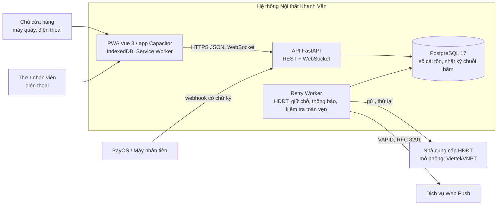

# Nội thất Khanh Vân: bán hàng, kho nhiều xưởng, công nợ và hóa đơn điện tử — noi_that_173820_n32

> Phần mềm bán hàng tại quầy và trên điện thoại cho một cửa hàng nội thất gỗ nhỏ. Phần mềm tính đúng giá hàng đặt theo
> kích thước riêng, giữ tồn kho của nhiều xưởng trên sổ cái không sửa được, theo dõi công nợ hai chiều và tự xếp hàng đợi
> hóa đơn điện tử, thay cho sổ tay và bản KiotViet mà cửa hàng đang dùng.

Đề tài do nhóm đề xuất (ngoài y tế). Slug `noi_that` đang **chờ giảng viên duyệt** đưa vào ngân hàng case study.

## 1. Giới thiệu sản phẩm

- **Bài toán:** cửa hàng bán đồ thờ, giường, tủ, bàn ghế gỗ. Nhiều món đặt theo kích thước khách yêu cầu nên giá tính tay
  theo mét dài, m² hoặc bậc kích thước. Hàng lấy từ nhiều xưởng. Khách có thể cọc hoặc mua chịu, và cửa hàng nợ lại
  xưởng. Cửa hàng phải xuất hóa đơn điện tử. Hiện tại giá và tồn kho chủ yếu nằm trong trí nhớ của chủ cửa hàng.
- **Người dùng đích:** chủ cửa hàng (lớn tuổi, cần chữ to, thao tác ít) và 1–2 thợ/nhân viên bán hàng bằng điện thoại.
- **Tính năng chính của MVP:**
  1. **Bán tại quầy:**
     - Tra giá tiếng Việt có dấu hoặc không dấu, hiểu kích thước viết tắt ("giuong 1m8 soi") và từ thường gọi ("bàn uống nước").
     - Hàng đặt riêng tính giá theo 3 công thức do chủ cấu hình. Đơn cũ giữ nguyên giá lúc bán.
     - Thu tiền qua mã VietQR.
  2. **Kho nhiều xưởng trên sổ cái chỉ ghi thêm:**
     - Hiển thị tồn hiện có, đang giữ và khả dụng.
     - Chống bán vượt tồn khi hai người bán cùng lúc. Bộ sản phẩm tự rã thành từng món.
     - Có kiểm kê và cảnh báo hàng sắp hết.
  3. **Giá 3 tầng và phân quyền:**
     - Thợ không bao giờ nhận được giá vốn hay giá sàn từ API.
     - Đơn bán dưới giá sàn phải chờ chủ duyệt; chủ nhận thông báo đẩy.
  4. **Thu tiền, công nợ, hóa đơn điện tử:**
     - Có cọc, bán chịu, xử lý lệch tiền, đối soát và công nợ từng xưởng.
     - Đơn thu đủ tự vào hàng đợi HĐĐT, Worker gửi và tự thử lại khi lỗi.
  5. **Nhật ký và điện thoại:**
     - Nhật ký thao tác nối chuỗi băm SHA-256, phát hiện sửa hoặc xóa lén.
     - PWA cài được trên Android/iOS, vẫn tra giá và lập đơn khi mất mạng.
- **Demo:** video 3–5 phút sẽ có ở Tuần 14. **Ảnh chụp:** [docs/](docs/) (Hình 1–7 ở mục 4).

## 2. Phạm vi MVP

| Trạng thái | Nội dung |
|---|---|
| ✅ Đã làm | Danh mục hàng có biến thể và thuộc tính theo nhóm; giá 3 tầng có lịch sử; 3 công thức giá hàng đặt riêng, chủ tự sửa; tìm kiếm tiếng Việt dưới 1 giây trên 20.000 mặt hàng; bán hàng, báo giá có link công khai, đặt cọc, bán chịu, trả hàng; sổ cái tồn, giữ chỗ 30 phút, bộ sản phẩm, phiếu nhập theo xưởng, kiểm kê; VietQR, webhook PayOS có chữ ký, "Máy nhận tiền" ký HMAC, xác nhận tay, lệch tiền, đối soát, chốt ngày; hàng đợi HĐĐT với Retry Worker (nhà cung cấp mô phỏng); công nợ khách và xưởng; phân quyền Chủ / Thợ / Quản trị; nhật ký chuỗi băm; PWA ngoại tuyến, thông báo đẩy Web Push, dự án app gốc Android/iOS (Capacitor); nhập danh mục từ file KiotViet; 236 test pytest + 31 test vitest, độ phủ backend 80 %, CI GitHub Actions; rà soát bảo mật (khóa ký tự sinh, chống dò mật khẩu, nâng thư viện hết lỗ hổng đã biết) và đo hiệu năng; user story kèm tiêu chí Given/When/Then, biểu đồ lớp và tuần tự trong báo cáo |
| 🚧 Đang làm | Chạy thử README trên máy sạch (Docker); kiểm thử trên điện thoại thật (ca MB-10 đến MB-15); đưa backlog Tuần 12–15 lên GitHub Issues |
| ⬜ Chưa làm | Xuất HĐĐT thật với Viettel S-Invoice / VNPT (adapter viết theo tài liệu công khai, chưa thử tài khoản thật); file PDF hóa đơn từ HĐĐT mô phỏng; màn hình sửa thành phần bộ sản phẩm; build APK/iOS và thông báo đẩy khi tắt app gốc (cần FCM/APNs); đo độ sẵn sàng 99,5 % (NFR-03) khi vận hành thật; review chéo, video demo (Tuần 14) |
| 🚫 Ngoài phạm vi | Tự xây hệ thống HĐĐT riêng (chỉ tích hợp nhà cung cấp hợp pháp); quản lý sản xuất, gia công đồ gỗ; vận chuyển, lịch thợ lắp; kết nối trực tiếp API ngân hàng (chỉ nhận qua PayOS hoặc Máy nhận tiền); nhiều chi nhánh; kế toán tổng hợp. Sản phẩm không có mô-đun AI |

## 3. Kiến trúc & công nghệ

Sơ đồ C4 mức Container (C1, C2 đầy đủ có trong báo cáo, mục 4.7):



- **CSDL:** PostgreSQL 17, dùng `unaccent`, `pg_trgm` và trigger PL/pgSQL. Sổ cái tồn và nhật ký bị trigger chặn sửa/xóa.
- **Backend:** Python 3.11 trở lên với FastAPI 0.165.0 (Starlette 1.10), uvicorn 0.34.2, psycopg 3.2.9 + psycopg-pool 3.2.6, argon2-cffi 23.1.0, PyJWT 2.15.0 và cryptography.
- **Frontend:** Vue 3.5.46, vue-router 4.5.0, Vite 6.4.6, Tailwind CSS 3.4.17, Dexie 4.0.11 và vite-plugin-pwa 1.3.0. App gốc dùng Capacitor 8.6.2.
- **Kiểm thử:** pytest 9.0.3 (+ pytest-cov) chạy trên CSDL thật, vitest 5.1.1, và GitHub Actions (`src/.github/workflows/kiem-thu.yml`).
- **Cấu trúc thư mục `src/`:**

```text
src/
├── database/migrations/   001–007: bảng, trigger bất biến, chỉ mục tìm kiếm, view tồn kho, thông báo đẩy
├── backend/
│   ├── app/domain/        logic thuần: đọc kích thước, công thức giá, VietQR
│   ├── app/services/      nghiệp vụ: hàng hóa, kho, đơn hàng, thanh toán, HĐĐT, nhật ký, thông báo đẩy
│   ├── app/routers/       REST API, kiểm tra quyền theo vai trò
│   ├── app/adapters/      HĐĐT, PayOS, lưu file Local/S3, Web Push
│   ├── app/worker.py      Retry Worker
│   ├── scripts/           smoke.py (đầu-cuối), do_hieu_nang.py (đo tải)
│   └── tests/             236 test pytest
├── frontend/              PWA Vue 3 (src/views: 12 màn hình), android/ và ios/ (Capacitor)
├── scripts/               setup.ps1, start.ps1, test.ps1, demo-public.ps1 (Windows)
└── docker-compose.yml     db + api + worker
```

## 4. Cài đặt & cách sử dụng

**Yêu cầu môi trường:** chọn một trong hai cách.

- **Cách A:** Docker Desktop.
- **Cách B:**
  - Python 3.11 trở lên.
  - Node.js 22 trở lên.
  - PostgreSQL 17 có superuser `postgres` / `postgres`. Nếu khác, đặt biến `PG_SUPERUSER_URL`.

```bash
# Cách A: Docker (lần đầu mất vài phút để tải image và build)
cd src
docker compose up -d --build          # mở http://localhost:8000

# Cách B: chạy trực tiếp
cd src/frontend && npm ci && npm run build
cd ../backend
python -m venv .venv && . .venv/bin/activate      # Windows: .venv\Scripts\activate
pip install -r requirements.txt
python -m app.bootstrap               # tạo role + CSDL khanhvan, migrate, nạp dữ liệu mẫu
uvicorn app.main:app --port 8000      # http://localhost:8000, tài liệu API: /docs
python -m app.worker                  # mở terminal thứ hai, cùng thư mục src/backend

# Chạy test (cần PostgreSQL như cách B; pytest tự dựng CSDL riêng khanhvan_test)
cd src/backend && python -m pytest -q     # 236 test; thêm --cov=app để đo độ phủ (cần pytest-cov)
cd src/frontend && npx vitest run         # 31 test (Node 22.12 trở lên)
```

Trên Windows có sẵn script: `powershell -ExecutionPolicy Bypass -File scripts\setup.ps1` rồi `scripts\start.ps1`.
Cách A chưa được chạy thử trên máy sạch; nhóm làm việc này trong Tuần 12 và sẽ ghi kết quả vào `report/TestReport_v1.md`.

**Dữ liệu và tài khoản mẫu (synthetic):** trang đăng nhập có nút chọn nhanh.

| Tài khoản | Mật khẩu | Vai trò |
|---|---|---|
| `covan` | `KhanhVan@2026` | Chủ cửa hàng |
| `anhnam` | `AnhNam@2026` | Thợ |
| `admin` | `Admin@2026` | Quản trị |

Đây là mật khẩu demo của dữ liệu mẫu, không phải tài khoản thật.

Dữ liệu mẫu gồm:
- 5 xưởng và 41 mặt hàng gỗ, trong đó 6 mặt hàng đặt theo kích thước, kèm các bộ sản phẩm.
- 4 đơn hàng dựng sẵn cho các kịch bản dưới đây.

**Kịch bản sử dụng:**

1. **Bán tủ thờ đặt theo kích thước** (Hình 2):
   - Đăng nhập `anhnam` → **Bán hàng** → gõ `tu tho` → chọn *Tủ thờ Gỗ Mít chạm sen (đặt theo mét dài)*.
   - Ô *Kích thước khách đặt* gõ `2m4` → **Tính**.
   - Giá **5.328.000 đ** (1.850.000 đ/m × 2,4 m × hệ số gỗ Mít 1,2). Thợ không thấy giá vốn hay giá sàn.
2. **Chủ duyệt bán dưới giá sàn** (Hình 1):
   - Đăng nhập `covan` → **Tổng quan**.
   - Khung *CẦN CHỦ DUYỆT* có đơn `#KV261027006` do thợ xin bán dưới giá sàn.
   - Bấm **Chủ duyệt** → đơn chuyển sang chờ thu tiền, thợ nhận thông báo.
3. **Xử lý khách chuyển thiếu tiền:**
   - Chủ vào **Đối soát & Chốt ngày**.
   - Khung *TIỀN VỀ CẦN XỬ LÝ* có giao dịch 17,0 triệu cho đơn `#KV261027005` 17,2 triệu.
   - Chọn **Tạo QR bù** để thu thêm, hoặc **Chấp nhận giảm** → đơn được chốt, kho tự xuất, HĐĐT vào hàng đợi (Hình 5).
4. **Kiểm tra kho và nhật ký:**
   - **Kho & Xưởng** hiện tồn hiện có / đang giữ / khả dụng; ô đỏ là hàng dưới ngưỡng tối thiểu (Hình 4).
   - **Nhân viên & Nhật ký** → **Kiểm tra toàn vẹn chuỗi** báo chuỗi băm hợp lệ (Hình 6).

| Hình | Màn hình |
|---|---|
| 1 | [Tổng quan](docs/01-tong-quan.png) |
| 2 | [Bán hàng, hàng đặt riêng](docs/02-ban-hang.png) |
| 3 | [Chủ sửa công thức giá](docs/03-cong-thuc-gia.png) |
| 4 | [Kho & Xưởng](docs/04-kho-xuong.png) |
| 5 | [HĐĐT & công nợ](docs/05-hddt-cong-no.png) |
| 6 | [Nhật ký, kiểm tra toàn vẹn](docs/06-nhat-ky.png) |
| 7 | [Giao diện điện thoại](docs/07-dien-thoai.png) |

## 5. Hướng phát triển Tuần 11–15

| Tuần | Mục tiêu | Đầu việc chính | Phụ trách (MSSV) | Tiêu chí hoàn thành | Trạng thái |
|:---:|---|---|---|---|:---:|
| 11 (18–23/11) | Chốt MVP & CI | Chốt phạm vi MVP; README 6 mục; CI GitHub Actions; xin duyệt slug đề tài; backlog T12–15 lên Issues | 202414375, 202413965 | MVP chạy theo README; CI xanh; backlog có người phụ trách; PR #1 qua `validate_submission.py` | 🚧 |
| 12 (24–30/11) | Kiểm thử & tích hợp | Test Report v1; đo độ phủ module lõi (mục tiêu ≥ 60 %); chạy README trên máy sạch; kiểm thử máy thật MB-10..15 | 202413965, 202414028 | Test chạy bằng một lệnh; có Test Report v1; luồng chính không lỗi nghiêm trọng | 🚧 |
| 13 (1–7/12) | Bảo mật & hiệu năng | Rà soát phân quyền, kiểm tra đầu vào, lộ secret; đo thời gian tìm kiếm và chốt đơn; ghi rõ sản phẩm không có mô-đun AI | 202414375, 202414028 | Không còn lỗi bảo mật mức cao đã biết; có số đo hiệu năng | ✅ |
| 14 (8–14/12) | Review chéo & code freeze | Review mã của một nhóm khác; xử lý góp ý nhận được; quay video demo 3–5 phút | Cả nhóm | Có nhận xét review chéo; code freeze; có video | ⬜ |
| 15 (15–21/12) | Nghiệm thu & bảo vệ | Tag `v1.0`; báo cáo cuối kỳ, slide, bảng Đã làm / Chưa làm; bảo vệ | Cả nhóm | Có release `v1.0`, README cuối, video, slide | ⬜ |

Cập nhật cột *Trạng thái* (⬜ chưa / 🚧 đang / ✅ xong) vào cuối mỗi tuần.

**Ghi chú tiến độ (24/11):**
- Tuần 11 trễ: README 6 mục và CI xong ngày 24/11. PR #1 chưa mở được, vì đề tài chưa có slug trong ngân hàng case study.
- Tuần 12:
  - Đã xong: Test Report v1, độ phủ 80 %.
  - Còn lại: chạy README trên máy sạch, kiểm thử trên điện thoại thật.
- Tuần 13 làm sớm ngày 24/11: rà soát bảo mật sửa 2 lỗi mức cao, đo hiệu năng (`report/BaoMat_HieuNang_v1.md`).

## 6. Nhóm & tuân thủ

- **Mã nhóm:** 173820_n32 (lớp 173820, nhóm N32).
- **Thành viên:**
  - `202414375` – Backend & Scrum Master
  - `202414028` – Frontend và app di động
  - `202413965` – Phân tích nghiệp vụ & kiểm thử
- **Zero PII:**
  - Khách hàng, xưởng, số điện thoại, mã số thuế và tài khoản trong dữ liệu mẫu (`src/backend/app/seed.py`, `hang_mau_bo_sung.py`) đều là giả lập.
  - File xuất danh mục KiotViet của cửa hàng (tên hàng, giá, tồn; không có thông tin cá nhân) không đưa vào bài nộp này.
  - Không có khóa API thật. Chỉ có `.env.example`, không commit `.env`.
- **Công cụ AI đã dùng & phạm vi:**

  | Công cụ | Dùng cho | Kiểm chứng |
  |---|---|---|
  | Claude Code (Anthropic) | Hỗ trợ viết mã bản 2 (backend, frontend, app di động), test tự động, CI, rà soát bảo mật, đo hiệu năng; cập nhật báo cáo, vẽ biểu đồ lớp và tuần tự; viết README, Test Report | Chạy lại toàn bộ 236 pytest + 31 vitest; đối chiếu biểu đồ với mã nguồn; người phụ trách từng phần đọc lại mã |
  | Antigravity (Google) | Dựng bản prototype 1 (không nằm trong `src/` của bài nộp) | Bộ test `tests/` của prototype |
  | Google Gemini | Phân tích yêu cầu, chuẩn hóa Use Case | Nhóm đối chiếu với phỏng vấn chủ cửa hàng |

- **Dữ liệu lớn (> 10 MB):** không có. File lớn nhất là báo cáo `.pdf`, 3,8 MB.

## Cấu trúc thư mục bài nộp

- `submission.json`, `README.md`
- `report/`:
  - `BaoCao_Tuan12.docx` / `.pdf`: báo cáo, gồm:
    - SRS: user story kèm Given/When/Then
    - Use Case, DFD, C4
    - thiết kế dữ liệu, biểu đồ lớp và tuần tự
    - kiểm thử, triển khai
    - phụ lục về công cụ AI
  - `TestReport_v1.md`: kết quả kiểm thử, độ phủ, truy vết yêu cầu
  - `BaoMat_HieuNang_v1.md`: rà soát bảo mật, đo hiệu năng, đánh giá AI (không áp dụng)
- `docs/`: ảnh chụp màn hình dùng trong README
- `src/`: mã nguồn bản 2
- `slides/`: slide thuyết trình (Tuần 15)
